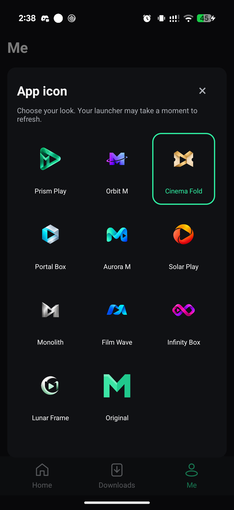
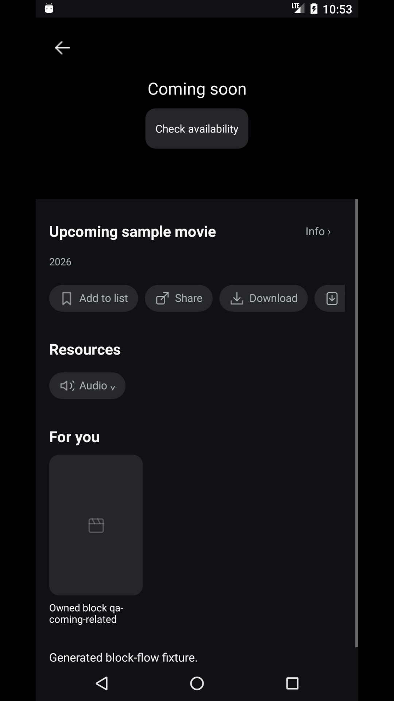
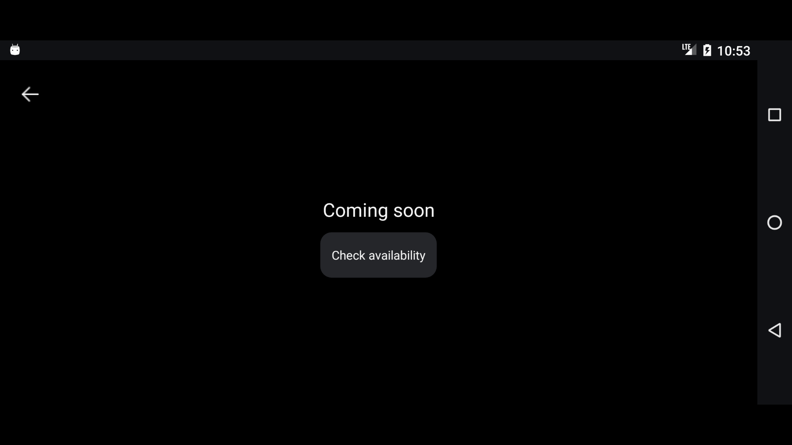

# MovieBox Android App

An independent native MovieBox client made for Android phones. Browse movies and
TV shows, choose available audio and subtitles, and continue where you left off.
The installed app is named **MovieBox**.

[Download the latest APK](https://github.com/emransm877/moviebox-android-native/releases/latest) | [All MovieBox projects](https://emransm877.github.io/moviebox-projects/) | [Report a problem](https://github.com/emransm877/moviebox-android-native/issues)




Historical 0.1.1 build 4 captures from the maintainer's Android 17 phone. The 0.1.3 layout has changed; these images are not current-build captures.

**Version 0.1.3 (build 6).** [Changes and exact validation scope](docs/releases/0.1.3.md).

## Get started

1. Open the latest release above and download the **MovieBox-Android-App-*.apk** attached to it.
2. Open the APK on your phone. Android may ask you to allow installation from your browser or file manager.
3. Install MovieBox, then open it. You can turn that installation permission off afterward.

Requires **Android 6.0 or newer** (API 23+), an internet connection and enough free
storage. It is designed for phones; use the separate Android TV project on a TV.
To update, install the newer APK over the existing app. Keep the same project and
signing identity to preserve its library. Uninstalling deletes private app data.

## What you can do

- Browse movies and TV shows, search with suggestions, and open a title from the home slider.
- Save your list and resume progress in this app's own local library.
- Back up or restore your list and progress under **Me**, without transferring downloaded videos or another app's private data.
- Play available video qualities with native Media3 playback; choose available audio and subtitles.
- Browse seasons and episodes inside the player and automatically continue a series.
- Seek with touch gestures, adjust volume on the right and brightness on the left, and change how video fits the screen.
- Download supported single-file videos for local playback. New downloads use Wi-Fi unless you explicitly allow mobile data for that file.
- Choose your appearance and one of ten additional launcher icons under **Me -> App icon**.
- Check for optional updates under **Me -> Check for updates**. Successful automatic checks are spaced twelve hours apart; failed checks can be retried. Updates are never forced or installed silently.
- Keep the chosen audio edition when retrying playback or changing episodes after a source failure.
- See **Coming soon** for a confirmed unavailable movie, with an explicit availability recheck. Connection and authorization failures remain retryable.

The 0.1.3 update removes the native app's 18+ restriction and its Settings switch. It does not include a parental-control guarantee.

## Android App or Android patch?

This is the independently authored **Android App**, package
`org.emransm.moviebox.phone`. The [Android patch](https://github.com/emransm877/moviebox-android)
is a separate modification of a specific upstream APK, with different requirements
(Android 10+/ARM64) and a separate package. Both display MovieBox when installed.
They can coexist, but their lists and history are separate. This app does not import
or overwrite the patch's private data.

## Know the limits

This is a community project, not an official MovieBox release. Account sign-in,
memberships, live channels and complete upstream feature parity are not included.
Title availability, artwork, languages, subtitles and actual qualities depend on
the external service. Network errors, expired links or missing tracks can occur.
A source without 720p cannot honestly be relabeled as 720p.

Version 0.1.3 passed 38 release unit tests, build and lint, 72 combined signed Android 6/API 23 emulator scenarios and one additional portrait/landscape visual scenario. A same-signer emulator update from the exact published 0.1.2 APK preserved the saved list, progress, audio/subtitle preferences and recent searches. These scenarios use owned media and controlled metadata. Physical installation and the owner's in-app update test remain pending; exact upstream feature/UI parity and universal compatibility are not claimed.




These current-build QA captures show the real app rendering synthetic metadata in an emulator. The older home/icon pictures above remain explicitly historical 0.1.1 phone captures.

Historically, version 0.1.1 passed 131 scoped scenarios on one Android 17 phone after a same-signer in-place update. Its 29 unit tests passed; lint reports zero errors and 89 warnings. That historical 0.1.1 result did not include exact-build Android 6 emulator coverage. These results do not guarantee every phone, decoder, launcher or Android version.
See [validation scope](docs/VALIDATION.md), [privacy](docs/PRIVACY.md),
[installation help](docs/INSTALLATION.md) and [security](SECURITY.md).

## Build from source

Use **JDK 17**, Android SDK **36**, and the included Gradle wrapper:

```sh
./gradlew :app:testDebugUnitTest :app:lintDebug :app:assembleDebug :app:assembleDebugAndroidTest
```

On Windows use `gradlew.bat`. The debug APK is in
`app/build/outputs/apk/debug/`. CI runs local checks and compiles instrumentation;
it does not claim physical-device testing or publish signed releases.
[Developer and release guide](docs/DEVELOPMENT.md).

## Ownership and notices

Independently authored source is MIT licensed. This does not license service
content, catalogue art, trademarks, upstream applications or media. No upstream
APK is required to build the source. Only access or download content you are
entitled to use. See [third-party notices](THIRD_PARTY_NOTICES.md).
