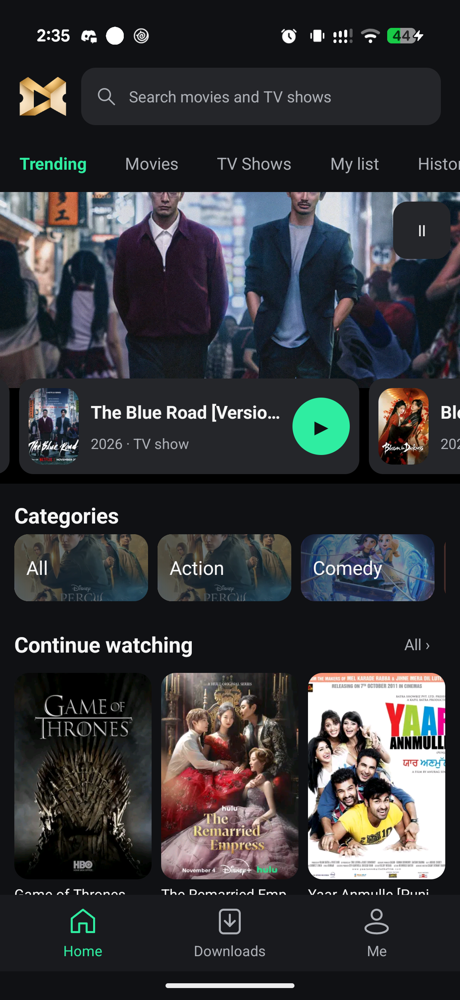

# MovieBox Android App

An independent native MovieBox client made for Android phones. Browse movies and
TV shows, choose available audio and subtitles, and continue where you left off.
The installed app is named **MovieBox**.

[Download the latest APK](https://github.com/emransm877/moviebox-android-native/releases/latest) | [All MovieBox projects](https://emransm877.github.io/moviebox-projects/) | [Report a problem](https://github.com/emransm877/moviebox-android-native/issues)



## Get started

1. Open the latest release above and download **MovieBox-Android-App-0.1.0.apk**.
2. Open the APK on your phone. Android may ask you to allow installation from your browser or file manager.
3. Install MovieBox, then open it. You can turn that installation permission off afterward.

Requires **Android 6.0 or newer** (API 23+), an internet connection and enough free
storage. It is designed for phones; use the separate Android TV project on a TV.
To update, install the newer APK over the existing app. Keep the same project and
signing identity to preserve its library. Uninstalling deletes private app data.

## What you can do

- Browse movies and TV shows, search with suggestions, and open a title from the home slider.
- Save your list and resume progress in this app's own local library.
- Play available video qualities with native Media3 playback; choose available audio and subtitles.
- Browse seasons and episodes inside the player and automatically continue a series.
- Seek with touch gestures, adjust volume on the right and brightness on the left, and change how video fits the screen.
- Download an available video for local playback, subject to the source and storage permissions.
- Choose your appearance and one of ten additional launcher icons under **Me -> App icon**.
- Check for optional updates under **Me -> Check for updates**. Background checks are at most every twelve hours; updates are never forced or installed silently.

## Android App or Android patch?

This is the independently authored **Android App**, package
`org.emransm.moviebox.phone`. The [Android patch](https://github.com/emransm877/moviebox-android)
is a separate modification of a specific upstream APK, with different requirements
(Android 10+/ARM64) and a separate package. Both display MovieBox when installed.
They can coexist, but their lists and history are separate. This app does not import
or overwrite the patch's private data.

## Know the limits

This is a community project, not an official MovieBox release. Account sign-in,
memberships, live channels and complete upstream feature parity are not included.
Title availability, artwork, languages, subtitles and actual qualities depend on
the external service. Network errors, expired links or missing tracks can occur.
A source without 720p cannot honestly be relabeled as 720p.

Android 17 on one physical phone and Android 6 in an emulator have been checked;
that is not a guarantee for every phone, decoder, launcher or Android version.
See [validation scope](docs/VALIDATION.md), [privacy](docs/PRIVACY.md),
[installation help](docs/INSTALLATION.md) and [security](SECURITY.md).

## Build from source

Use **JDK 17**, Android SDK **36**, and the included Gradle wrapper:

```sh
./gradlew :app:testDebugUnitTest :app:lintDebug :app:assembleDebug :app:assembleDebugAndroidTest
```

On Windows use `gradlew.bat`. The debug APK is in
`app/build/outputs/apk/debug/`. CI runs local checks and compiles instrumentation;
it does not claim physical-device testing or publish signed releases.
[Developer and release guide](docs/DEVELOPMENT.md).

## Ownership and notices

Independently authored source is MIT licensed. This does not license service
content, catalogue art, trademarks, upstream applications or media. No upstream
APK is required to build the source. Only access or download content you are
entitled to use. See [third-party notices](THIRD_PARTY_NOTICES.md).
